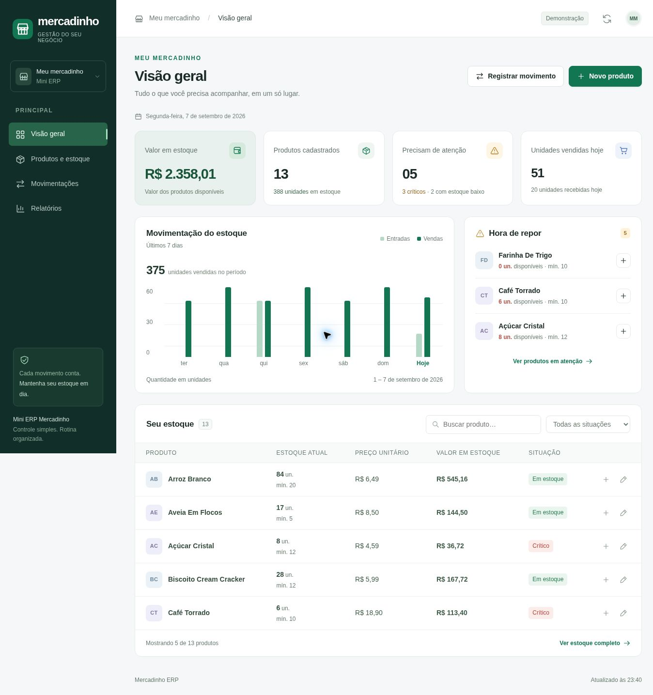

# Mini-ERP-Mercadinho
Sistema de gerenciamento de estoque desenvolvido em Python para pequenos comerciantes.

## Interface web — branch `frontend/painel-mercadinho`

Painel responsivo em português, com visão geral, produtos e estoque, movimentações
e relatórios. Mantém os arquivos e o programa de terminal originais. Esta versão
está em uma branch de revisão; não foi integrada à `main`.

### Experimentar com dados de demonstração

Requer **Python 3.10 ou superior**. Não é preciso instalar pacotes Python ou Node.
Dentro da pasta do projeto, execute:

```bash
git switch frontend/painel-mercadinho
python3 web_server.py --demo
```

Abra **http://localhost:4173** no navegador do mesmo computador. No Windows,
substitua `python3` por `py`. Use `Ctrl+C` para encerrar.

Os exemplos ficam em `.erp-demo/`, fora do Git. Cadastro, edição e movimentos
nesse modo alteram somente os exemplos. O selo **Demonstração** identifica essa
base. Na primeira execução são criados produtos e um histórico de exemplo
consistente com as quantidades finais; nas próximas execuções as alterações são
preservadas.

### Usar os dados do próprio projeto

Feche o programa de terminal antes de iniciar a versão web sobre os mesmos
arquivos. Execute apenas um processo por pasta de dados:

```bash
python3 web_server.py
```

Esse modo lê e grava `Estoque.json` e `Historico_de_movimentações.json`, mantendo
as chaves utilizadas por `funçoes.py`. Para testar uma cópia dos seus dados:

```bash
python3 web_server.py --data-dir /caminho/da/copia
```

O servidor é local, sem login, e por padrão aceita conexões apenas do próprio
computador. Não é uma publicação para acesso pela internet e não deve ser
exposto publicamente. O `package.json` contém apenas o comando para a prévia
supervisionada; o uso normal requer somente Python.

### O que funciona no painel

- **Visão geral:** valor do estoque, quantidades, unidades vendidas no dia,
  gráfico de entradas e vendas dos últimos sete dias e alertas de reposição.
- **Produtos:** busca com ou sem acentos, filtros por situação, cadastro,
  reposição, edição de quantidade/preço/mínimo e exclusão de produtos zerados
  com confirmação. O histórico é preservado na exclusão.
- **Movimentações:** registro de vendas e compras, prévia da quantidade final,
  histórico com filtros por produto, operação e data, além de paginação.
- **Relatórios:** valor médio por produto, distribuição por situação e rankings
  de unidades mais vendidas e recebidas. Entradas incluem compras e cadastros.
- **Persistência:** validação no servidor, bloqueio de estoque negativo,
  gravação atômica por arquivo e diário para recuperar operações interrompidas.
  Formulários antigos não sobrescrevem alterações recentes no produto.

O nome usa letras e espaços para continuar compatível com o terminal. As
quantidades são inteiras e os preços aceitam até duas casas decimais. Os limites
de alerta são os mesmos do projeto original: crítico abaixo do mínimo; baixo
do mínimo até menos de 1,4× o mínimo; normal a partir de 1,4× o mínimo.

**Relatórios financeiros:** o preço original não distingue custo de compra de
preço de venda, e o histórico antigo não armazena o preço de cada operação.
Assim, os valores exibidos representam o estoque a preço unitário atual.
Faturamento e lucro não são calculados a partir desses dados.

### Verificação

```bash
python3 -m unittest discover -s tests -v
node --check frontend/app.js  # opcional, se houver Node instalado
```

Os testes usam pastas temporárias e verificam compatibilidade dos JSON,
persistência, concorrência, vendas inválidas, formulários desatualizados,
validação, recuperação de gravação interrompida e proteções HTTP.

### Capturas da interface local

Dados de demonstração, após os testes de cadastro, edição, venda e reposição.
O layout para celular foi inspecionado em uma área de 390 × 844 pixels.



[Ver captura para celular](docs/previews/mobile.jpg)

### Estrutura da versão web

```text
web_server.py       Servidor HTTP local e arquivos estáticos
erp_web.py          Adaptador dos JSON e operações da interface
frontend/          HTML, CSS, JavaScript e ícone locais
tests/             Testes de integração com dados temporários
docs/previews/     Capturas reais da interface em execução
```

O programa original continua disponível com `python3 compras.py`. Suas funções
interativas não foram reescritas; a interface usa um adaptador compatível com os
mesmos dados. A proteção de concorrência vale dentro de uma instância do servidor
web. Não execute o terminal, outra instância ou edições manuais ao mesmo tempo.

## Sobre o projeto
Este projeto foi desenvolvido para resolver um problema comum em pequenos comércios:

- controle manual de estoque
- dificuldade para acompanhar produtos
- falta de alertas de reposição

O sistema permite gerenciar produtos através de um terminal em Python.

## Funcionalidades

* Cadastro de produtos
* Controle de estoque
* Reposição de mercadorias
* Registro de vendas
* Atualização de preços
* Configuração de estoque mínimo
* Alertas automáticos de reposição
* Relatório financeiro

  * Valor total do estoque
  * Valor médio por produto
* Relatório situacional

  * Produtos em estoque baixo
  * Produtos em situação crítica
* Resumo gerencial

  * Total de produtos cadastrados
  * Quantidade de produtos em alerta
  * Quantidade de produtos com estoque baixo
  * Quantidade de produtos em situação normal
* Histórico de movimentações
  
  * Registro de compras
  * Registro de vendas
  * Registro de novos cadastros
  * Data e hora das operações
  * Ranking de produtos mais vendidos
  * Ranking de produtos mais comprados
* Persistência de dados em JSON


## Tecnologias utilizadas

- Python
- JSON

## Estrutura do projeto

funcoes.py
compras.py
Estoque.json
Historico_de_movimentações.json

## Arquivo de exemplo

O arquivo `Estoque.json` presente no repositório consta vazio para que o usuário consiga testar o sistema desde o início; validando, portanto, o histórico de movimentações de cada ação.
## Como executar

1. Baixe os arquivos do projeto
2. Certifique-se de ter Python instalado
3. Execute:

python compras.py

## Melhorias futuras

- Exportação para Excel
- Integração com Pandas
- Dashboard Gerencial
